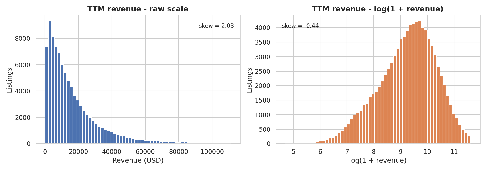
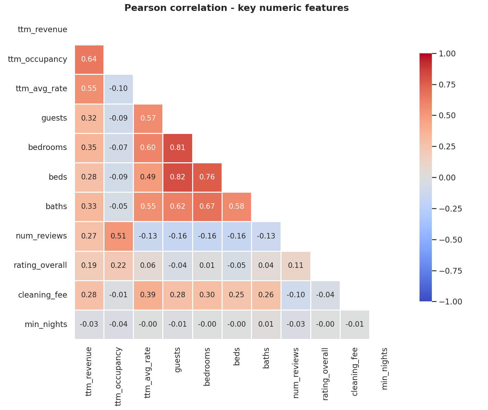
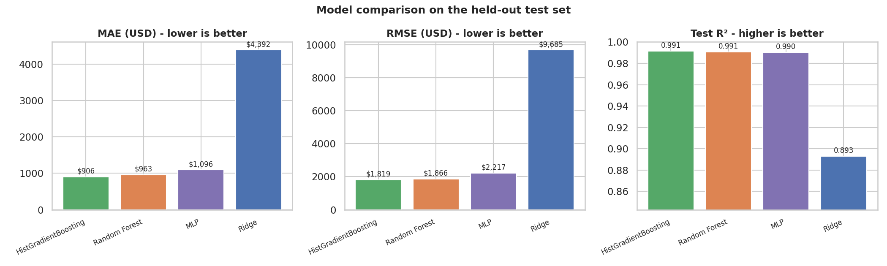
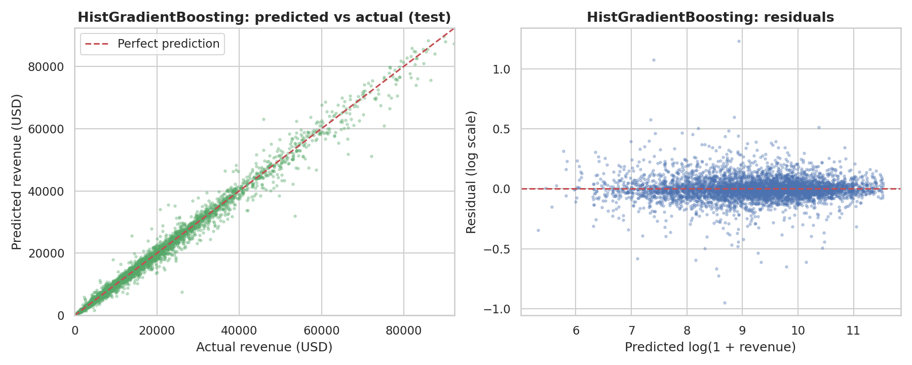
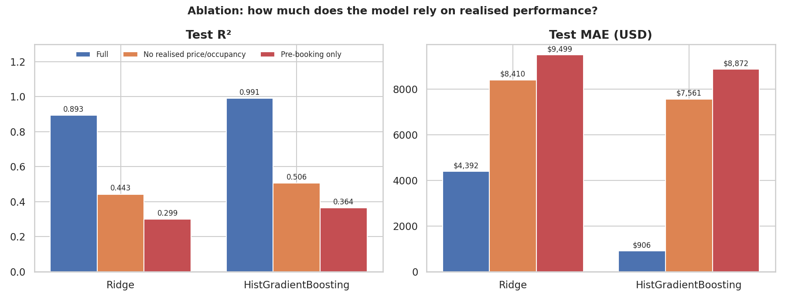
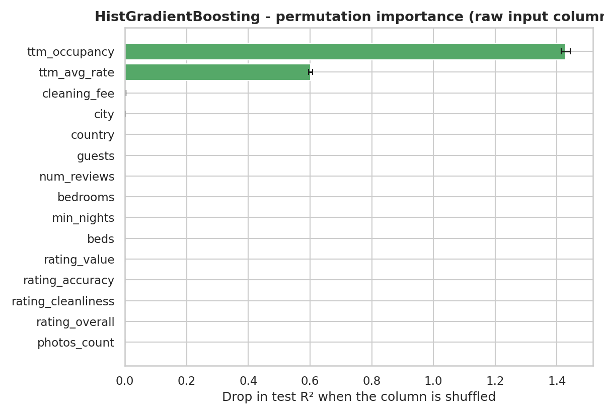
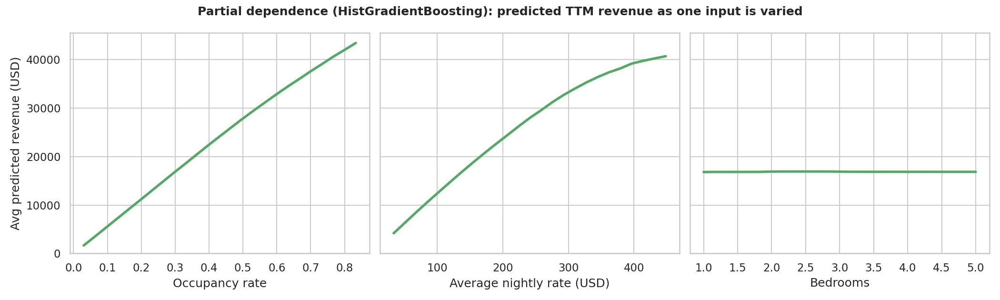
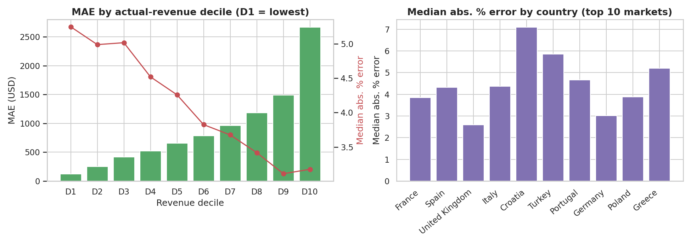
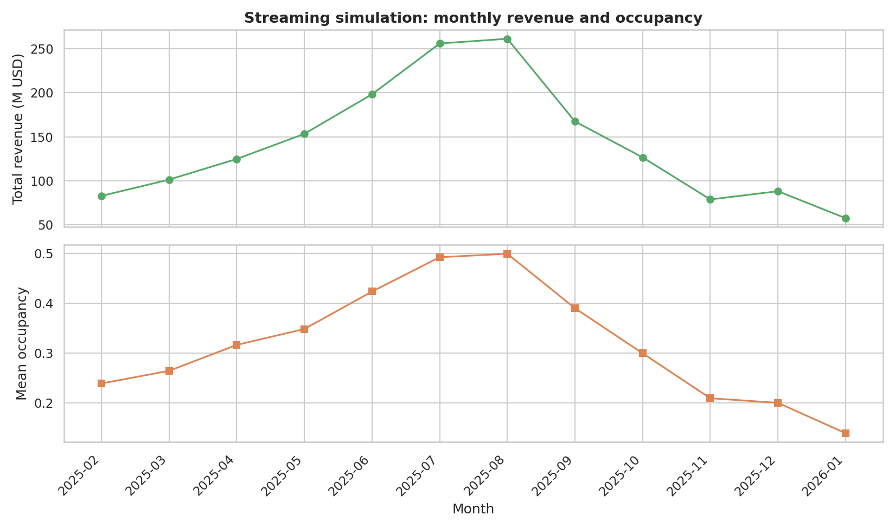

# Technical Report: Predicting Airbnb TTM Revenue

All numbers in this report are produced by the code in this repository and are
stored in `reports/tables/` (and `outputs/`); every figure is generated by
`python make_figures.py`. Where the original coursework write-up differs, the
difference is listed explicitly in [Section 8](#8-differences-from-the-original-coursework-report).

**Execution environment for every result below:** 1 CPU core, 3 GB RAM,
scikit-learn 1.8, pandas 3.0, Python 3.12. `xgboost`, `pyarrow`, `pyspark` and
`shap` were not available there; see [Section 9](#9-limitations-and-what-was-not-run).

## 1. Problem

Predict a listing's trailing-twelve-month (TTM) gross revenue (USD) from
property, host, review, pricing and market attributes. Useful to hosts
(pricing), investors (due diligence) and analysts (market structure).

## 2. Data

Source: an Airbnb analytics export (`listings`, 95,898 rows x 61 columns; and
`past_rates`, 1,115,174 monthly rows).

| | |
|---|---|
| Raw listings | 95,898 |
| After cleaning | **92,937** |
| Countries / cities | 36 / 373 |
| TTM revenue mean / median / std | $16,865 / $11,647 / $16,757 |
| Mean occupancy / mean nightly rate | 31.2% / $145.18 |
| Skewness of revenue: raw / log(1+x) | 2.03 / -0.44 |

**Cleaning** (`src/preprocessing/cleaning.py`): drop rows whose `listing_id` is
not numeric (about 570 rows in the CSV export are column-shifted by free text
with embedded line breaks); coerce numeric columns; map booleans (case
insensitive); keep `0 < revenue <` 99th percentile, `0 < rate <` 99th
percentile and occupancy in [0, 1]. Missing values are *not* imputed here -
that happens inside the model pipeline (Section 3).

**Exploratory findings.**
Revenue is right-skewed ([Fig 1](figures/fig01_revenue_distribution.png)), so
models are trained on `log(1 + revenue)` and scored back in USD. Median
revenue is highest in Iceland ($25.1k), Ireland ($24.2k) and the Netherlands
($22.2k) ([Fig 2](figures/fig02_revenue_by_country.png)). The strongest
correlates of revenue are occupancy (r = 0.64) and nightly rate (r = 0.55);
guests/bedrooms/baths sit at 0.32-0.35, ratings at 0.19
([Fig 4](figures/fig04_correlation_heatmap.png)).




## 3. Method

### 3.1 Pipeline and leakage control

```
raw columns -> FeatureEngineer -> ColumnTransformer -> regressor
```

The whole chain is a single scikit-learn `Pipeline`, tuned end to end with
`GridSearchCV` (R², 3 or 5 folds per `configs/model_config.yaml`).

* `FeatureEngineer` is **stateful**: `fit()` learns the per-city mean rate /
  occupancy and the top-10 countries from the rows it is given (inside CV: the
  training fold) and `transform()` reuses them; unseen cities fall back to the
  global mean, unseen countries to "Other". No target value is used.
* The `ColumnTransformer` median-imputes and standard-scales numeric columns and
  mode-imputes and one-hot-encodes categoricals; it is also fit on training
  folds only.
* No feature is derived from `ttm_revenue`; `tests/test_features.py` asserts it.
* Train/test split: 80/20, `random_state=42` -> 74,349 / 18,588 listings.

### 3.2 Features (29 = 27 numeric + 2 categorical)

Eleven groups: composite rating (`rating_avg`, `rating_std`); capacity ratios;
log transforms; cleaning-fee ratio; interactions (`rate_x_reviews`,
`revpar_proxy` = occupancy x rate, `size_x_rating`); market-relative
(`price_vs_city_mean`, `occ_vs_city_mean`); country grouping. See
`docs/feature_engineering.md`.

### 3.3 Models and grids

| Model | Grid actually searched | Selected |
|---|---|---|
| Ridge | alpha in {0.1, 1, 10, 100, 500}, 5-fold | alpha = 0.1 |
| Random Forest | 200 trees, depth 10, min leaf 2 (single configuration), 3-fold | as given |
| HistGradientBoosting | learning rate {0.05, 0.1} x max leaf nodes {31, 63}, 300 iterations, 3-fold | lr 0.1, 31 leaves |
| MLP | (128, 64), alpha 0.001, lr 0.001, early stopping, 3-fold | as given |
| XGBoost | defined in config; **not run** here | - |

`HistGradientBoostingRegressor` (scikit-learn) is a histogram-based boosted-tree
model in the same family as XGBoost/LightGBM. It is reported under its own name
and is **not** a substitute for an XGBoost result.

## 4. Results

Held-out test set, 18,588 listings (`reports/tables/benchmark_results.csv`):

| Model | MAE | RMSE | R² test | R² CV (5-fold) | R² train | Grid-search time (1 core) |
|---|---|---|---|---|---|---|
| **HistGradientBoosting** | **$906** | **$1,819** | **0.9913** | 0.9913 ± 0.0004 | 0.9923 | 67 s |
| Random Forest | $963 | $1,866 | 0.9907 | 0.9905 ± 0.0005 | 0.9928 | 430 s |
| MLP | $1,096 | $2,217 | 0.9902 | 0.9899 ± 0.0009 | 0.9914 | 229 s |
| Ridge | $4,392 | $9,685 | 0.8929 | 0.8916 ± 0.0011 | 0.8922 | 20 s |




* The three non-linear models are within 0.001 R² of each other; the gap to
  Ridge (0.099 R², roughly 4.8x the MAE) is the non-linearity of
  `revenue ~ rate x occupancy`, which a linear model on the raw inputs cannot
  represent.
* Train, test and CV R² agree to within 0.0025 for every model
  ([Fig 11](figures/fig11_generalisation.png),
  [Fig 15](figures/fig15_cv_stability.png)): there is no sign of overfitting or
  of an unlucky split.
* Residuals on the log scale are centred on zero with no visible trend
  against the prediction ([Fig 10](figures/fig10_best_model_pred_vs_actual.png), right).
* Timings are `GridSearchCV` wall-clock on one core and depend on grid size
  (Random Forest searched 1 configuration, HistGB 4); they are not a like-for-like
  speed comparison ([Fig 16](figures/fig16_runtime_vs_accuracy.png)).

## 5. What the model relies on (ablation)

Because revenue is approximately rate x booked nights, a model given the
realised rate and occupancy is close to solving an identity. To measure this,
the same models were re-trained on reduced feature sets
(`benchmark.py --feature-set ...`; definitions in `configs/training_config.yaml`):

| Feature set | Features | HistGB R² | HistGB MAE | Ridge R² | Ridge MAE |
|---|---|---|---|---|---|
| Full | 29 | 0.9913 | $906 | 0.8929 | $4,392 |
| No realised price/occupancy | 21 | 0.5062 | $7,561 | 0.4426 | $8,410 |
| Pre-booking only (also no reviews/ratings) | 15 | 0.3636 | $8,872 | 0.2988 | $9,499 |



**Interpretation.** Removing the two realised-performance inputs (and the
features derived from them) cuts R² from 0.99 to 0.51; also removing
review-derived features, which exist only after a listing has hosted guests,
leaves 0.36. The headline accuracy is therefore an *estimation of revenue from
observed performance*, valuable for an existing listing but not a forecast for
a new one. For brand-new listings the realistic expectation from the available
attributes is R² of roughly 0.35-0.5 and a mean absolute error of $7.5-9k.

## 6. Explainability and error analysis

Computed with scikit-learn only (`src/explainability/analysis.py`), on the
best model, using raw input columns so derived features are recomputed.

* **Permutation importance** ([Fig 8](figures/fig08_permutation_importance.png)):
  shuffling occupancy lowers test R² by 1.43, shuffling nightly rate by 0.60; the
  next most important input (cleaning fee) costs 0.003. In the Random Forest,
  `revpar_proxy` holds 99.7% of impurity importance
  ([Fig 7](figures/fig07_random_forest_importance.png)).
* **Partial dependence** ([Fig 18](figures/fig18_partial_dependence.png)):
  predicted revenue rises almost linearly with occupancy (about $1.7k at 3% occupancy to
  $43.4k at 83%, the 2nd-98th percentile range) and concavely with nightly rate; bedrooms, with everything
  else held fixed, move the prediction by only about $100 (on a ~$16.8k base) - capacity matters through
  price, not independently of it.
* **Error analysis** ([Fig 19](figures/fig19_error_analysis.png)): median
  absolute percentage error is ~5% in the lowest revenue decile and ~3% in the
  top two, while absolute error grows with revenue ($120 MAE in D1, $2,669 in
  D10). By market: UK 2.6%, Germany 3.0%, France 3.8%, ... Turkey 5.8%, Croatia
  7.1% (ten largest countries; `reports/tables/error_by_country.csv`).





## 7. Big-data techniques

| Technique | Result |
|---|---|
| **Batch processing**, 10,000-row chunks | Batch means range from $13.6k to $20.1k (overall $16.9k): the first batch is ~19% above and the last ~19% below the mean. The export is **not randomly ordered**; per-chunk statistics are not exchangeable, so chunked/out-of-core processing here needs shuffling or stratification ([Fig 12](figures/fig12_batch_processing.png)). The last batch holds only 2,937 rows. |
| **Streaming simulation**, month by month over 1,115,174 rows | Clear seasonality: total revenue climbs from $83M (Feb 2025) to $261M (Aug 2025), then falls to $58M (Jan 2026); mean occupancy 0.24 -> 0.50 -> 0.14 ([Fig 13](figures/fig13_streaming_trend.png)). |
| **CPU parallelism** | Needs a multi-core machine; the committed figure uses the timings reported by the original 8-core run (14.6 s, 4.1 s, 2.6 s for 1, 4 and 8 jobs) and is labelled as such. Reproduce live with `python -m src.spark.cpu_parallelism` ([Fig 14](figures/fig14_cpu_parallelism.png)). |
| **Memory** | float64 -> float32: 158.5 MB -> 141.5 MB (-10.7%); the saving is modest because string columns dominate. |
| **GPU / PySpark** | Implemented (`xgboost_model.detect_device`, `src/spark/*`), **not executed** here. Quoted GPU speed-ups (10-30x) are literature/vendor figures, not measurements from this project. |



## 8. Differences from the original coursework report

The coursework report was written from a different run. Re-running everything
from the raw export surfaced these differences; this repository reports the
re-run values.

| Item | Coursework report | This reproduction |
|---|---|---|
| Listings after cleaning | 93,423 | 92,937 (CSV export has ~570 corrupted rows; the parquet export was not readable here) |
| Skewness raw -> log | 4.2 -> 0.31 | 2.03 -> -0.44 (measured on the cleaned data) |
| Corr(revenue, occupancy / rate) in text | 0.71 / 0.58 | 0.64 / 0.55 - which is also what the report's own heatmap showed |
| Hyper-parameter table | RF depth 15 / leaf 3; XGBoost regularisation tuned | The grids in the submitted script are smaller (e.g. a single RF configuration); this repo reports only searched values |
| MLP | Test R² 0.979, RMSE $23,895, CV std ±0.046, described as unstable | R² 0.990, RMSE $2,217, CV std ±0.0009. The report's own Figures 9 and 15 showed ~0.988 and ±0.001, i.e. its Table 4 disagreed with its figures |
| "Tree models beat deep learning on tabular data" | Used to explain the MLP | **Not supported here**: MLP is within 0.001 R² of the trees (MAE $1,096 vs $906) |
| Best model | XGBoost, R² 0.990, MAE $961 | HistGradientBoosting R² 0.9913, MAE $906; XGBoost not run |
| Batch revenue "stable" (no positional bias) | Stated | Not supported: batch means differ by up to ~$6k |
| Leakage statement | "all transformations fit on training data only" | Not true of the original code (city means and top countries were computed on the full data before the split). Fixed here: `FeatureEngineer` learns them in `fit()` inside the pipeline |

## 9. Limitations and what was not run

* **Realised price/occupancy dominate** (Section 5). Treat the headline R² as
  in-sample estimation of observed performance.
* **Not executed in the build environment:** XGBoost, SHAP
  (`notebooks/04_SHAP.ipynb`), PySpark (`src/spark/spark_train.py`), the live
  multi-core benchmark, and the parquet exports. All have code and, where
  possible, tests; run them locally to extend the tables.
* Hyper-parameter grids are small; larger grids are a config change.
* One random split plus 5-fold CV on the training set; no repeated-seed
  confidence interval on the test metrics (CV std is 0.0004-0.0011).
* Revenue is defined over a trailing window while reviews/ratings accumulate
  over the listing's lifetime, so even the "pre-booking" set is only an
  approximation of what is knowable at launch.

## 10. Reproducing

See the README section "Reproduce the full results". All tables:
`reports/tables/`; row-level test predictions: `outputs/predictions.csv`.

## References

1. T. Chen and C. Guestrin, "XGBoost: A scalable tree boosting system", KDD, 2016.
2. L. Breiman, "Random forests", Machine Learning 45(1), 2001.
3. A. E. Hoerl and R. W. Kennard, "Ridge regression: Biased estimation for nonorthogonal problems", Technometrics 12(1), 1970.
4. S. Kaufman et al., "Leakage in data mining: Formulation, detection, and avoidance", ACM TKDD 6(4), 2012.
5. S. M. Lundberg and S.-I. Lee, "A unified approach to interpreting model predictions", NeurIPS 30, 2017.
6. L. Grinsztajn, E. Oyallon and G. Varoquaux, "Why do tree-based models still outperform deep learning on typical tabular data?", NeurIPS 35, 2022.
7. G. Zervas, D. Proserpio and J. W. Byers, "The rise of the sharing economy: Estimating the impact of Airbnb on the hotel industry", J. Marketing Res. 54(5), 2017.
